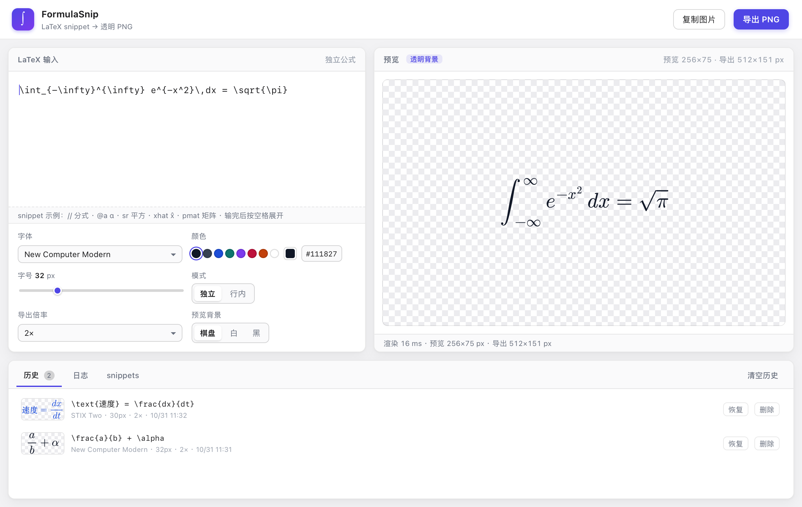

# FormulaSnip

> 独立于 DeepSeek Harness 的 macOS 公式小工具：**LaTeX-suite 风格 snippet 输入 → 可选字体、颜色的透明 PNG**，导出后直接拖进 PowerPoint / Keynote。

**GitHub**：[DEVbyQIN/formula-snip](https://github.com/DEVbyQIN/formula-snip)　·　**下载**：[macOS](https://github.com/DEVbyQIN/formula-snip/releases/latest)　·　[Windows 预览](https://github.com/DEVbyQIN/formula-snip/releases/tag/v1.0.0-windows.1)



- 完全离线：MathJax 与 6 套公式字体已经打包进 App，不联网、不依赖 TeX，也不需要 DSH。
- 透明 PNG：导出图默认透明背景，插入 PPT 不会带白底。
- 历史 + 日志：每次导出/复制自动留档（含缩略图），可单条删除或清空；日志可清空。
- 原生 macOS App（Swift + WKWebView），不是从 DSH 里打开的面板。

## 安装

1. 从 [Releases](https://github.com/DEVbyQIN/formula-snip/releases/latest) 下载 `FormulaSnip-1.0.0.dmg`，把 **FormulaSnip.app** 拖进「应用程序」；或者用仓库源码自行构建（见下文）。
2. 本包为本地 ad-hoc 签名、未公证。若系统提示"无法验证开发者"，在 Finder 里 **右键 → 打开** 一次即可。
3. 系统要求：macOS 11+。当前包是 Intel（x86_64）构建；Apple Silicon 机器可直接运行（Rosetta），也可以在目标机器上按「自行构建」重新编译。

> 也可以直接用 `dist/FormulaSnip-1.0.0.zip` 解压使用。

## 使用

- 左边输入 LaTeX（不用写 `$` 或 `$$`），右边实时预览。输入 snippet 触发词后按 **空格** 展开，按 **Tab** 在占位符之间跳转，**Esc** 退出占位符。
- 字体、颜色、字号、导出倍率、独立/行内模式都在左下角；预览背景可切棋盘/白/黑（导出始终透明）。
- **⌘E** 导出 PNG；**⌘⇧C** 复制图片到剪贴板。
- 底部的「历史 / 日志 / snippets」：历史可恢复、删除、清空；日志可清空；snippets 面板可搜索并点击插入。
- 配置与历史保存在 `~/Library/Application Support/FormulaSnip/state.json`。

### snippet 速查（MathJax 数学模式常用子集）

| 输入 | 展开 | 说明 |
|---|---|---|
| `//` | `\frac{}{}` | 分式 |
| `sr` / `cb` | `^{2}` / `^{3}` | 平方 / 立方 |
| `_` | `_{}` | 下标 |
| `sq` | `\sqrt{ }` | 根号 |
| `@a` … `@O` | `\alpha` … `\Omega` | 希腊字母 |
| `xhat` / `xbar` / `xvec` | `\hat{x}` … | 字母直接加帽/向量 |
| `x3` | `x_{3}` | 变量后数字自动下标 |
| `pmat` / `bmat` / `vmat` | `pmatrix` 等 | 矩阵环境 |
| `align` | `\begin{aligned}` | 多行对齐 |
| `sum` / `\sum` | `\sum` / 带上下限 | 求和 |
| `int` / `dint` / `oint` | 积分 | 不定 / 定 / 环路 |
| `par` / `ddt` | 偏导 / 时间导数 | 微积分 |
| `->` `>=` `!=` `===` | `\to` `\geq` `\neq` `\equiv` | 常用关系 |
| `and` `inn` `set` `RR` | `\cap` `\in` `\{ \}` `\mathbb{R}` | 集合与常用符号 |
| `lr(` `lr[` `lr{` | 自动大小括号 | 括号 |
| `bra` `ket` `brk` | 量子力学 bra-ket | 已内置宏 |
| `kbt` `dag` `msun` | 物理常用写法 | 物理 |

另有：`text`、`bf`、`cal`、`bb`、`hat`、`bar`、`ddot`、`tilde`、`vec`、`pmod`、`tayl`、`iso`、`he4`、`avg`、`norm`、`ceil`、`floor`、`mod`、`lra` 等。完整的定义在 `app/web/snippets.js`，可以自行增删（`trigger` / `rep` / `category` / `desc`）。

### 关于字体

内置 6 套 MathJax 4 字体：New Computer Modern（默认）、Latin Modern、STIX Two、Pagella、Fira Math、TeX 经典。它们都是公式字体，不是任意系统字体；MathJax 不支持的 `\usepackage`、任意宏包不会工作，但 AMS 常用环境（`aligned`、`matrix`、`pmatrix`、`cases` 等）都支持。内置了 `bra`/`ket`/`braket`/`abs`/`norm`/`degree`/`dd` 几个常用宏。

中文写在 `\text{…}` 里，渲染时使用 macOS 系统字体回退（导出图里也是同样的字形）。

## Electron 版（Windows 适配的前置工作）

macOS 的正式安装包仍是上面的原生版（Swift + WKWebView，约 26 MB）。为了让 Windows 能用，仓库另外包含一套 **Electron 宿主**：前端 snippet / 渲染 / 导出 / 历史代码完全复用，只替换原生壳。

- 已实现：窗口、菜单、保存对话框、剪贴板、状态文件、`--selftest` 自检；前端通过宿主无关的 `window.formulasnip` 桥工作
- 已在 macOS 上验证 Electron 版：开发运行、打包后的 `.app` 与 `.dmg` 自检全绿
- Windows 安装包已通过 GitHub Actions `windows-latest` 构建：[v1.0.0-windows.1 预览版](https://github.com/DEVbyQIN/formula-snip/releases/tag/v1.0.0-windows.1)（未签名、未实机验收；`npm run electron:win` 也可在 Windows 本机构建）
- Electron 自带 Chromium，Windows 上不依赖 WebView2；代价是体积大：本次 macOS 构建 `.app` 约 300 MB，ZIP 123 MB / DMG 141 MB，Windows NSIS 预计同量级

```bash
npm install                                   # 会安装 electron + electron-builder
scripts/prepare-vendor.sh app/web/vendor
npm run electron                              # 本机开发运行
npm run electron:selftest                     # 自动化自检（截图 + 原生桥）
scripts/build-electron.sh                     # macOS：.app + dmg + zip → dist-electron/
# Windows（需在 Windows 或 GitHub Actions windows-latest 上执行）：
npm run electron:win                          # NSIS 安装包
```

状态路径：macOS `~/Library/Application Support/FormulaSnip/state.json`，Windows `%APPDATA%\FormulaSnip\state.json`。


## 自行构建（macOS 原生版）

需要：macOS + Xcode Command Line Tools（`swiftc`）、Node 20+ 与 npm（**只在准备 MathJax 资源时用到**；运行 App 不需要 Node、TeX 或 DSH）。

```bash
cd formula-snip
npm install                                   # 安装 mathjax 与 6 套字体包
scripts/prepare-vendor.sh app/web/vendor      # 拷贝最小运行资源（约 24 MB）
scripts/build-app.sh                          # 产出 dist/FormulaSnip.app
scripts/make-dmg.sh                           # 产出 dist/FormulaSnip-1.0.0.dmg + .zip
```

Apple Silicon 原生构建：在 Apple Silicon Mac 上直接执行上面的 `build-app.sh` 即可（脚本用本机 `swiftc` 编译）。

## 测试

```bash
# 无头 Chrome 的 Web UI 自检（snippet、渲染、透明 PNG、颜色、CJK、历史）
node scripts/web-selftest.mjs

# 原生 WKWebView 自检：真实 WebKit 渲染 + 原生桥 + 快照
dist/FormulaSnip.app/Contents/MacOS/FormulaSnip --selftest /tmp/fs-selftest
# 暗色模式截图：追加 --dark
```

自检覆盖：snippet 展开（纯引擎 + 界面按键模拟）、`\text{}` 内不展开、MathJax 渲染、PNG 透明/尺寸/颜色、CJK 文本、字体切换、历史增删、原生状态保存、原生 PNG 写盘。

## 已知边界

- PNG 不写 DPI 元数据；插入 PPT 后按需要缩放即可。倍率越高像素越多，清晰度越好。
- 预览的「棋盘格」只是显示辅助；导出的 PNG 始终透明（角落 alpha = 0）。
- App 未公证；分发给别人时需要对方右键打开一次，或自行签名/公证。
- 历史与日志存在本机，不会上传；清空历史/日志只影响本地记录。

## 许可

App 代码 MIT（见 `LICENSE`）。MathJax 与字体数据为 Apache-2.0，详见 [THIRD_PARTY_NOTICES.md](THIRD_PARTY_NOTICES.md)。
